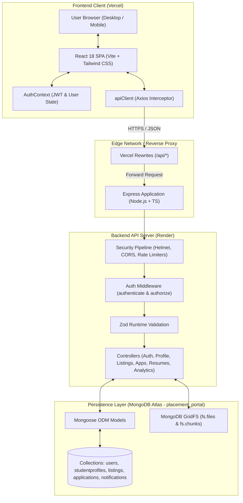
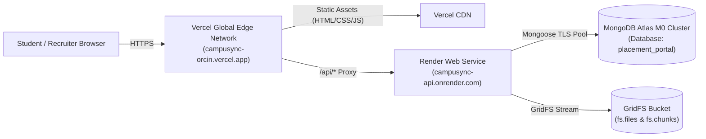

# CampuSync — Student Placement & Internship Management Portal

[](https://www.typescriptlang.org/)
[](https://react.dev/)
[](https://nodejs.org/)
[](https://expressjs.com/)
[](https://www.mongodb.com/)
[-brightgreen.svg)](https://github.com/jojo16-cyber/campusync)
[](https://campusync-orcin.vercel.app)
[](https://campusync-api.onrender.com/api/health)

A full-stack web application engineered to automate and streamline the campus recruitment and internship lifecycle for students, campus recruiters, and the Training and Placement Office (TPO).

---

## 📌 Table of Contents

- [Problem Statement & Overview](#-problem-statement--overview)
- [Complete Implemented Features](#-complete-implemented-features)
  - [Student Capabilities](#1-student-capabilities)
  - [Administrator & Placement Officer Capabilities](#2-administrator--placement-officer-capabilities)
- [Technology Stack](#-technology-stack)
- [System Architecture](#-system-architecture)
- [Authentication, Authorization & Database Design](#-authentication-authorization--database-design)
- [Project Directory Structure](#-project-directory-structure)
- [Prerequisites & Environment Setup](#-prerequisites--environment-setup)
- [Installation & Local Run Instructions](#-installation--local-run-instructions)
- [Available Scripts](#-available-scripts)
- [Testing Instructions & Verified Results](#-testing-instructions--verified-results)
- [Production Deployment Architecture](#-production-deployment-architecture)
- [Application Screenshots](#-application-screenshots)
- [Comprehensive Documentation Suite](#-comprehensive-documentation-suite)
- [Limitations & Future Roadmap](#-limitations--future-roadmap)

---

## 📖 Problem Statement & Overview

In higher education institutions, campus recruitment drives are traditionally managed through an ad-hoc combination of Google Forms, shared spreadsheets, Telegram groups, and manual email notifications. This operational fragmentation introduces critical points of failure:

1. **Recruiter & TPO Overhead**: Ineligible students submit applications that placement officers must manually screen and discard against CGPA and branch cutoffs.
2. **Missed Deadlines**: Students lack a unified dashboard to monitor application deadlines, eligibility criteria, and interview schedules.
3. **Data Inconsistency**: Disconnected resumes and academic records scattered across email attachments lead to evaluation errors and privacy risks.
4. **Lack of Analytics**: Placement officers struggle to calculate real-time placement rates, company-wise application volumes, and department-level hiring metrics.

**CampuSync** solves these challenges by providing a unified, role-based platform that automates eligibility evaluation, enforces recruitment state transitions, streams candidate resumes natively from the database, and delivers real-time placement analytics.

---

## ✨ Complete Implemented Features

### 1. Student Capabilities

- **Secure Registration & Authentication**:
  - Student registration with strict role enforcement (client cannot escalate role to `admin`).
  - Bcrypt salted password hashing (12 rounds) with complexity validation.
  - Stateless JWT authentication with automatic Bearer token injection.
- **Academic Profile Management**:
  - Real-time **Profile Completeness Scorer** evaluating 10 core fields (Name, Phone, Roll Number, Institution, Department, Degree, Graduation Year, CGPA, Skills, Bio).
  - Department dropdown supporting all standard engineering branches (CSE, IT, ECE, EEE, MECH, CIVIL, AI/ML, DS, etc.).
  - CGPA validation within the standard $0.00$ to $10.00$ range.
  - Social and portfolio link integration (GitHub, LinkedIn, Personal Portfolio).
- **Opportunity Discovery & Exploration**:
  - Filter listings by opportunity type (`internship`, `full_time`, `internship_and_full_time`), work arrangement (`on_site`, `hybrid`, `remote`), and status.
  - Search by company name, job title, and required skills.
  - Detailed listing view displaying compensation (CTC/stipend), locations, round details, and deadline countdown.
- **Automated Eligibility Evaluator**:
  - Instant academic eligibility evaluation (`eligible`, `ineligible`, or `incomplete_profile`) before applying.
  - Fuzzy department matching with acronym resolution (e.g., `Computer Science and Engineering (CSE)` matches `CSE`).
  - Strict minimum CGPA cutoffs, graduation cohort matching, and published application window checks.
  - Diagnostic breakdown showing required vs. actual values for each criterion.
- **One-Click Application Tracking**:
  - Application submission with optional cover letter.
  - Compound database index prevents duplicate submissions to the same listing.
  - Full application history tracking across 7 distinct pipeline stages.
  - Early-stage voluntary withdrawal permitted while in `submitted` or `under_review` status.
- **Secure Resume Management**:
  - Upload PDF resumes (up to 5 MB) validated against binary magic bytes (`%PDF-`).
  - Binary storage and streaming via MongoDB GridFS without server disk dependency.
  - Preview, download, and delete current resume with active status tracking (`not_uploaded`, `uploaded`, `verified`).
- **In-App Notification Center**:
  - Bell notification dropdown with unread badge counter.
  - Automatic notification triggers whenever an administrator updates an application stage.
  - Mark single notification as read, mark all as read, and click-to-navigate directly to the application.

---

### 2. Administrator & Placement Officer Capabilities

- **Privileged Administrative Access**:
  - Dedicated administrator authentication and route protection (`authorize('admin')`).
  - CLI provisioning tool (`npm run seed:admin`) with email normalization and secure password updates.
- **Placement Drive & Listing Management**:
  - Full CRUD operations: Create, read, update, and manage recruitment drives.
  - Multi-status lifecycle: `draft`, `published`, and `closed`.
  - Configurable eligibility parameters: Minimum CGPA, eligible departments whitelist, eligible graduation years whitelist, and application deadline timestamps.
  - Detailed opportunity metadata: Job description, requirements, selection rounds, location, and salary/stipend figures.
- **Applicant Pipeline & Candidate Review**:
  - Listing-specific applicant rosters with status tab filtering.
  - Paginated applicant views showing candidate details, academic profiles, and cover letters.
  - Single-click resume download streaming candidate resumes directly from GridFS.
  - Recruitment lifecycle state machine (`VALID_STATUS_TRANSITIONS`):
    - `submitted` $\to$ `under_review` $\to$ `shortlisted` $\to$ `interview_scheduled` $\to$ `selected` / `rejected`.
    - Terminal status locking for `selected`, `rejected`, and `withdrawn` records.
- **Placement Analytics & Dashboard**:
  - **7 Core KPIs**: Total Registered Students, Active Drives, Total Applications, Unique Selected Students, Total Offers Extended, Placement Rate (%), and Selection Rate (%).
  - **Deduplicated Placement Rate**: Calculated using `Application.distinct('student', { status: 'selected' })` to prevent candidates with multiple offers from skewing the metric.
  - **Status Distribution**: Percentage and count breakdown across all 7 recruitment statuses.
  - **Top Recruiter Applications**: Aggregation pipeline grouping applications by company name.
  - **Recruitment Funnel Pipeline**: Aggregated volume in review, interviewing, selected, rejected, and withdrawn.
  - **Live Activity Feed**: Real-time log of the latest applicant submissions with candidate summaries.

---

## 💻 Technology Stack

| Layer | Technologies | Purpose |
|---|---|---|
| **Frontend** | React 18, TypeScript, Vite, Tailwind CSS | Single-page application, responsive UI, rapid client-side rendering |
| **Icons & UI** | Lucide React | Clean, accessible iconography |
| **Client Routing** | React Router v6 | Role-based protected routes, declarative navigation |
| **HTTP Client** | Axios | Request/response interceptors, automatic JWT injection, error handling |
| **Backend Runtime** | Node.js (v18+ / v22+), Express | RESTful API server, asynchronous non-blocking event-driven architecture |
| **Backend Language** | TypeScript 5.7 | End-to-end static typing, interface contracts |
| **Database** | MongoDB Atlas, Mongoose 8.9 ODM | NoSQL document persistence, schema validation, aggregation pipelines |
| **Binary Storage** | MongoDB GridFS | 255KB chunked resume streaming without external storage bucket costs |
| **Validation** | Zod 3.24 | Runtime request payload validation and schema parsing |
| **Security** | Helmet, CORS, Bcrypt.js, JsonWebToken, express-rate-limit | HTTP header hardening, rate limiting, salted password hashing, stateless auth |
| **File Parsing** | Formidable 3.5 | Multipart form-data parser for binary PDF uploads |
| **Testing** | Vitest, React Testing Library, Jest, Supertest, ts-jest | Unit, integration, and end-to-end API test suites |
| **Deployment** | Vercel (Client), Render (API), MongoDB Atlas (Data) | Production cloud deployment with HTTPS and reverse proxying |

---

## 🏛️ System Architecture



---

## 🔐 Authentication, Authorization & Database Design

### Authentication & Authorization

- **Stateless Tokens**: Signs JSON Web Tokens (`HS256`) containing `{ userId, email, role }` with a 7-day expiration.
- **Role-Based Guards**:
  - `authenticate`: Verifies the incoming Bearer token, rejects expired or malformed signatures, and attaches the user document to `req.user`.
  - `authorize(...roles)`: Verifies that `req.user.role` matches the required privilege level (`admin` vs `student`).
- **Student Isolation & IDOR Defense**:
  - Students can only query or withdraw their own applications via `Application.findOne({ _id: id, student: req.user._id })`.
  - User enumeration defenses return identical `401 Unauthorized` responses for invalid emails and invalid passwords.

### Database Architecture & Integrity

- **Target Database**: `placement_portal` hosted on MongoDB Atlas.
- **Entity Collections**:
  - `users`: Core credentials, roles (`student`, `admin`), email uniqueness.
  - `studentprofiles`: 1-to-1 relationship with `users` (`userId` unique index), storing academic and contact parameters.
  - `listings`: Recruitment drives with embedded `eligibility` criteria subdocuments and status indexes.
  - `applications`: Relational links between students and listings, indexed by `{ student: 1, listing: 1 }` (unique compound index).
  - `resumes`: Resume metadata linked to students and GridFS `fileId`.
  - `notifications`: In-app candidate notification documents.
  - `fs.files` & `fs.chunks`: Binary chunks of PDF documents managed by MongoDB GridFS.

---

## 📂 Project Directory Structure

```
placement-portal/
├── client/                               # Frontend Single-Page Application
│   ├── public/                           # Static assets
│   ├── src/
│   │   ├── api/                          # Axios client and URL normalization
│   │   │   ├── client.ts                 # Base Axios instance & auth interceptors
│   │   │   └── client.test.ts            # Client network interceptor tests
│   │   ├── components/                   # Shared UI components
│   │   │   ├── Navbar.tsx                # Navigation header & user dropdown
│   │   │   ├── NotificationBell.tsx      # In-app notification bell & popover
│   │   │   ├── NotificationBell.test.tsx # Notification tests
│   │   │   └── ProtectedRoute.tsx        # Client-side RBAC route guard
│   │   ├── context/                      # Global state providers
│   │   │   └── AuthContext.tsx           # Authentication state machine & methods
│   │   ├── pages/                        # View controllers & application pages
│   │   │   ├── ApplicationsPage.tsx      # Student applications roster & status cards
│   │   │   ├── ApplicationsPage.test.tsx # Applications view tests
│   │   │   ├── DashboardPage.tsx         # Dual-mode dashboard (Admin Analytics vs Student)
│   │   │   ├── DashboardPage.test.tsx    # Dashboard view tests
│   │   │   ├── ListingsPage.tsx          # Opportunities discovery & admin CRUD modal
│   │   │   ├── ListingsPage.test.tsx     # Listings view tests
│   │   │   ├── LoginPage.tsx             # Dual-role authentication form
│   │   │   ├── ProfilePage.tsx           # Student profile editor & GridFS resume manager
│   │   │   ├── ProfilePage.test.tsx      # Profile view tests
│   │   │   └── RegisterPage.tsx          # Student onboarding form
│   │   ├── App.tsx                       # Master routing configuration & error boundaries
│   │   ├── App.test.tsx                  # Root integration tests
│   │   ├── index.css                     # Tailwind CSS directives
│   │   └── main.tsx                      # React 18 DOM bootstrap entry point
│   ├── .env.example                      # Client environment configuration template
│   ├── tailwind.config.js                # Tailwind CSS design system configuration
│   └── vite.config.ts                    # Vite build tool and Vitest configuration
│
├── server/                               # Backend RESTful API Server
│   ├── src/
│   │   ├── config/                       # System configuration & environment loaders
│   │   │   ├── db.ts                     # Mongoose connection & placement_portal selector
│   │   │   └── env.ts                    # Zod environment variable validation & fail-fast checks
│   │   ├── controllers/                  # HTTP request handlers
│   │   │   ├── analytics.controller.ts   # Placement analytics & KPI handlers
│   │   │   ├── application.controller.ts # Student application lifecycle & admin reviews
│   │   │   ├── auth.controller.ts        # Register, login, session inspection handlers
│   │   │   ├── health.controller.ts      # Service & database health checks
│   │   │   ├── listing.controller.ts     # Placement drive CRUD & publishing handlers
│   │   │   ├── notification.controller.ts# In-app notification read/unread handlers
│   │   │   ├── profile.controller.ts     # Student profile & completion score handlers
│   │   │   ├── resume.controller.ts      # GridFS resume upload, stream, and delete
│   │   │   └── student.controller.ts     # Admin student directory handlers
│   │   ├── middlewares/                  # Express middleware pipeline
│   │   │   ├── auth.middleware.ts        # JWT verification & role authorization
│   │   │   ├── errorHandler.ts           # Centralized operational error & 404 handler
│   │   │   ├── rateLimiter.ts            # Auth & general endpoint rate limiters
│   │   │   └── validate.middleware.ts    # Zod request body/query validation middleware
│   │   ├── models/                       # Mongoose data models & schemas
│   │   │   ├── application.model.ts      # Application schema & VALID_STATUS_TRANSITIONS
│   │   │   ├── listing.model.ts          # Recruitment drive schema & eligibility criteria
│   │   │   ├── notification.model.ts     # Notification schema
│   │   │   ├── profile.model.ts          # Student profile & 10-field completeness score
│   │   │   ├── resume.model.ts           # Resume metadata model
│   │   │   └── user.model.ts             # User credentials & password hashing hooks
│   │   ├── routes/                       # Route declarations
│   │   │   ├── analytics.routes.ts       # /api/analytics endpoints
│   │   │   ├── application.routes.ts     # /api/applications endpoints
│   │   │   ├── auth.routes.ts            # /api/auth endpoints
│   │   │   ├── health.routes.ts          # /api/health endpoint
│   │   │   ├── index.ts                  # Central API router aggregator
│   │   │   ├── listing.routes.ts         # /api/listings endpoints
│   │   │   ├── notification.routes.ts    # /api/notifications endpoints
│   │   │   ├── profile.routes.ts         # /api/profile endpoints
│   │   │   ├── resume.routes.ts          # /api/resumes endpoints
│   │   │   └── student.routes.ts         # /api/students endpoints
│   │   ├── scripts/                      # Management & database maintenance CLI tools
│   │   │   └── seedAdmin.ts              # Production admin account creation & promotion CLI
│   │   ├── services/                     # Business logic services
│   │   │   ├── analytics.service.ts      # KPI aggregations & deduplication algorithms
│   │   │   └── storage/
│   │   │       └── gridfs.storage.ts     # GridFS upload, stream, and delete operations
│   │   ├── utils/                        # Shared utility functions
│   │   │   ├── apiResponse.ts            # Standardized API response formatters
│   │   │   ├── appError.ts               # Custom operational application error class
│   │   │   ├── eligibility.ts            # Eligibility evaluator & department normalizer
│   │   │   └── fileValidation.ts         # PDF magic byte verification & sanitization
│   │   ├── validators/                   # Zod validation schemas
│   │   ├── app.ts                        # Express application composition & middleware setup
│   │   ├── server.ts                     # Node.js HTTP server listener & graceful shutdown
│   │   └── __tests__/                    # Backend Jest & Supertest integration test suites
│   ├── .env.example                      # Server environment configuration template
│   └── tsconfig.json                     # Server TypeScript compiler configuration
│
├── docs/                                 # Architectural & Technical Documentation
│   ├── study_guide/                      # Comprehensive Viva & Technical Study Guide
│   │   ├── 01_PROJECT_OVERVIEW.md        # Full project overview & feature audit
│   │   ├── 02_ARCHITECTURE_AND_LIFECYCLE.md # End-to-end request lifecycles & diagrams
│   │   ├── 03_FRONTEND_DEEP_DIVE.md      # Frontend architecture & testing guide
│   │   ├── 04_BACKEND_DEEP_DIVE.md       # Backend subsystems & complete API catalog (26 endpoints)
│   │   ├── 05_DATABASE_AND_MODELS.md     # Mongoose models & Entity-Relationship diagram
│   │   ├── 06_SECURITY_AND_AUTHENTICATION.md # Security architecture, Bcrypt, and RBAC
│   │   ├── 07_BUSINESS_LOGIC_AND_ALGORITHMS.md # Eligibility engine, state machine, analytics
│   │   ├── 08_VIVA_AND_INTERVIEW_PREP.md # 30 technical interview Q&A & presentation script
│   │   └── README.md                     # Study guide navigation hub
│   ├── ARCHITECTURE.md                   # System architecture reference
│   └── DATABASE_DESIGN.md                # Database design reference
│
├── Screenshots/                          # Deployed Application Visual Proofs
│   ├── Admin/                            # Administrator portal screenshots
│   └── student 1/                        # Student portal screenshots
│
├── package.json                          # Root orchestration with npm workspaces
├── render.yaml                           # Render cloud deployment specification
├── vercel.json                           # Vercel frontend routing & reverse proxy rules
└── .gitignore                            # Exclusion rules for node_modules, .env, and dist
```

---

## ⚙️ Prerequisites & Environment Setup

### Prerequisites

- **Node.js**: v18.0.0 or higher (v22+ recommended)
- **npm**: v8.0.0 or higher
- **MongoDB**: Local MongoDB instance (`mongodb://localhost:27017`) or a MongoDB Atlas connection URI

### Environment Setup

1. **Clone the repository**:
   ```bash
   git clone https://github.com/jojo16-cyber/campusync.git
   cd campusync
   ```

2. **Configure Backend Environment Variables**:
   ```bash
   cp server/.env.example server/.env
   ```
   Edit `server/.env` with your parameters:
   ```ini
   PORT=5001
   NODE_ENV=development
   MONGODB_URI=mongodb://localhost:27017/placement_portal
   MONGODB_DB_NAME=placement_portal
   CORS_ORIGIN=http://localhost:5173
   JWT_SECRET=your_super_secret_jwt_key_at_least_32_characters_long
   JWT_EXPIRES_IN=7d
   ADMIN_NAME=System Administrator
   ADMIN_EMAIL=admin@campasync.edu
   ADMIN_PASSWORD=ChangeThisAdminPassword123!
   ```

3. **Configure Frontend Environment Variables**:
   ```bash
   cp client/.env.example client/.env
   ```
   Edit `client/.env` with your parameters:
   ```ini
   VITE_API_BASE_URL=http://localhost:5001/api
   VITE_APP_TITLE=CampuSync - Student Placement Portal
   ```

---

## 🚀 Installation & Local Run Instructions

1. **Install dependencies across all workspaces**:
   ```bash
   npm install
   ```

2. **Provision the Initial Administrator Account**:
   ```bash
   npm run seed:admin
   ```
   *Optionally pass custom credentials via flags:*
   ```bash
   npm run seed:admin --workspace=server -- --email=officer@university.edu --password=SecurePassword123! --name="Placement Officer"
   ```

3. **Run Both Client and Server Concurrently**:
   ```bash
   npm run dev
   ```
   - **Frontend Application**: [http://localhost:5173](http://localhost:5173)
   - **Backend API Server**: [http://localhost:5001](http://localhost:5001)
   - **API Health Check**: [http://localhost:5001/api/health](http://localhost:5001/api/health)

---

## 📜 Available Scripts

The repository uses npm workspaces to coordinate commands across the root, client, and server packages:

| Command | Workspace | Verified Action |
|---|---|---|
| `npm run dev` | Root | Runs backend (tsx) and frontend (Vite) concurrently with colored terminal logs |
| `npm run dev:server` | Server | Starts Express TypeScript backend in watch mode (`tsx watch src/server.ts`) |
| `npm run dev:client` | Client | Starts Vite React frontend development server on port 5173 |
| `npm run build` | Root | Compiles backend (`tsc`) and builds optimized frontend assets (`vite build`) |
| `npm run build:server` | Server | Compiles backend TypeScript to production JavaScript in `dist/` |
| `npm run build:client` | Client | Performs type-checking (`tsc`) and generates production bundle in `dist/` |
| `npm run test` | Root | Executes both backend Jest test suites and frontend Vitest test suites |
| `npm run test:server` | Server | Executes 13 backend Jest test suites with supertest integration |
| `npm run test:client` | Client | Executes 7 frontend Vitest test suites with React Testing Library |
| `npm run lint` | Root | Runs ESLint across both server and client source files with zero allowed warnings |
| `npm run type-check` | Root | Runs strict TypeScript compiler check (`tsc --noEmit`) across both workspaces |
| `npm run seed:admin` | Server | Provisions or updates the initial administrator account in MongoDB |

---

## 🧪 Testing Instructions & Verified Results

CampuSync features a test suite covering unit logic, React DOM component rendering, and end-to-end HTTP API request handling.

```bash
# Run all tests across the repository
npm run test

# Run backend tests only
npm run test:server

# Run frontend tests only
npm run test:client

# Run strict type checking across all workspaces
npm run type-check

# Run linting across all workspaces
npm run lint
```

### Verified Test Results

```
========================= TEST EXECUTION SUMMARY =========================
Backend Test Suites (Jest + Supertest):     13 passed (13 total)
Backend Tests Passed:                       159 passed (159 total)
--------------------------------------------------------------------------
Frontend Test Suites (Vitest + RTL):         7 passed (7 total)
Frontend Tests Passed:                        70 passed (70 total)
--------------------------------------------------------------------------
TOTAL VERIFIED TESTS:                       229 PASSED (20 SUITES)
TypeScript Type Checks:                     0 Errors (Passed Cleanly)
ESLint Static Analysis:                     0 Errors, 0 Warnings (Passed Cleanly)
==========================================================================
```

#### Verified Test Suites Breakdown:
1. `auth.test.ts`: Registration, login, user enumeration defense, password hashing, role lockdowns.
2. `applications.test.ts`: Application submission, duplicate rejection, candidate isolation, admin reviews, and status machine transitions.
3. `resumes.test.ts`: PDF magic byte validation (`%PDF-`), 5MB limits, GridFS chunk streaming, and deletion.
4. `listings.test.ts`: Listing creation, editing, status changes, and student visibility filters.
5. `profile.test.ts`: Profile retrieval, updates, and 10-field completion calculations.
6. `analytics.test.ts`: KPI calculations, distinct student deduplication, status distributions, and company counts.
7. `notifications.test.ts`: Notification creation, mark-as-read, and unread count tracking.
8. `database.test.ts`: Explicit `placement_portal` dbName selection and credential masking.
9. `productionSecurity.test.ts`: Production startup fail-fast checks preventing weak default secrets.
10. `seedAdmin.test.ts`: Admin CLI argument parsing, password updating, and account promotion.
11. `errorHandler.test.ts`: Centralized error handling, operational AppError formatting, and MongoDB errors.
12. `rateLimiter.test.ts`: Auth rate limiting and general request ceiling tests.
13. `health.test.ts`: `/api/health` connectivity and database status reports.
14. `App.test.tsx`: Route rendering and navigation tests.
15. `DashboardPage.test.tsx`: Dual-mode dashboard rendering and analytics cards.
16. `ListingsPage.test.tsx`: Opportunities listing, search, filtering, and admin creation modal.
17. `ApplicationsPage.test.tsx`: Student applications list, status badges, and withdrawal modal.
18. `ProfilePage.test.tsx`: Student profile editing and resume upload/download flows.
19. `NotificationBell.test.tsx`: Notification popover, badge count, and mark-all-read.
20. `client.test.ts`: Axios base URL normalization and Bearer token attachment.

---

## 🌐 Production Deployment Architecture

CampuSync is deployed across cloud platforms with automated continuous delivery:



- **Frontend Application**: Hosted on **Vercel**
  - **Production URL**: [https://campusync-orcin.vercel.app](https://campusync-orcin.vercel.app)
  - Configured via `vercel.json` with reverse proxy rewrites directing `/api/(.*)` to the Render API server.
- **Backend API**: Hosted on **Render** (Oregon Region)
  - **API Root**: [https://campusync-api.onrender.com](https://campusync-api.onrender.com)
  - **Health Check Endpoint**: [https://campusync-api.onrender.com/api/health](https://campusync-api.onrender.com/api/health)
  - Automatic zero-downtime deployment from `origin/main` via `render.yaml`.
- **Database & Storage**: Hosted on **MongoDB Atlas**
  - Explicitly connects to the `placement_portal` database.
  - Houses all user records, student profiles, listings, applications, notifications, and GridFS resume chunks.

---

## 📸 Application Screenshots

The repository includes visual proof of the deployed production application located in the `Screenshots/` directory:

### Administrator Portal Views

| View | Screenshot | Description |
|---|:---:|---|
| **Placement Analytics & Metrics** |  | Real-time KPI metrics, application status distribution charts, and company-wise application volumes. |
| **Top Recruiter Insights & Pipeline** |  | Recruiter company application distribution ranking and hiring pipeline velocity stages. |
| **Candidate Review & Recent Applications** |  | Recent candidate application submissions roster with status badges and drive type breakdowns. |
| **Placement Opportunities & Drive Management** |  | Opportunity listings catalog with search, filter tabs, "+ Post New Opportunity", and listing controls (Applicants, Close, Edit, Delete). |

### Student Portal Views

| View | Screenshot | Description |
|---|:---:|---|
| **Student Workspace & Quick Actions** |  | Student dashboard with session status, unread notification counter, and quick navigation links. |
| **Student Profile & Completion Progress** |  | 10-field academic profile editor with 100% completion progress bar, personal info, and academic score inputs. |
| **In-App Notification Center & Alerts** |  | In-app notification popover displaying unread status update alerts and direct navigation links to applications. |
| **Student Application Tracking & Pipeline** |  | Application timeline tracking with stage badges (Submitted, Selected & Offered) and early withdrawal capability. |

---

## 📚 Comprehensive Documentation Suite

For detailed technical evaluation, viva defense preparation, and code walkthroughs, refer to the study guide modules in [docs/study_guide/](docs/study_guide/README.md):

1. [**Module 1: Project Overview & Objectives**](docs/study_guide/01_PROJECT_OVERVIEW.md) — Problem statement, user personas, complete directory tree, and feature matrix.
2. [**Module 2: Architecture & Request Lifecycle**](docs/study_guide/02_ARCHITECTURE_AND_LIFECYCLE.md) — Mermaid architecture diagrams and line-by-line sequence traces of core user flows.
3. [**Module 3: Frontend Deep Dive**](docs/study_guide/03_FRONTEND_DEEP_DIVE.md) — React 18 bootstrap sequence, AuthContext state machine, and component test walkthroughs.
4. [**Module 4: Backend Deep Dive & API Catalog**](docs/study_guide/04_BACKEND_DEEP_DIVE.md) — Express server lifecycle, error handling, rate limiters, and complete 26-endpoint API reference.
5. [**Module 5: Database Design & Mongoose Models**](docs/study_guide/05_DATABASE_AND_MODELS.md) — Entity-Relationship (ER) diagram, schema definitions, compound indexes, and lifecycle hooks.
6. [**Module 6: Security & Authentication**](docs/study_guide/06_SECURITY_AND_AUTHENTICATION.md) — Bcrypt hashing, stateless JWT mechanics, RBAC middleware, and IDOR prevention.
7. [**Module 7: Business Logic & Algorithms**](docs/study_guide/07_BUSINESS_LOGIC_AND_ALGORITHMS.md) — Eligibility evaluation engine, fuzzy department normalizer, and placement analytics deduplication.
8. [**Module 8: College Viva Defense & Interview Q&A**](docs/study_guide/08_VIVA_AND_INTERVIEW_PREP.md) — 15-minute presentation script, architectural decision defenses, and top 30 technical viva Q&A.
9. [**System Architecture Guide**](docs/ARCHITECTURE.md) — Technical middleware pipeline and controller patterns.
10. [**Database Design Reference**](docs/DATABASE_DESIGN.md) — Mongoose schemas and entity relationships.

---

## 🚧 Limitations & Future Roadmap

To maintain complete transparency regarding system boundaries, the following distinctions exist between currently implemented capabilities and planned future enhancements:

### Current Limitations
- **In-App Notifications Only**: Status updates generate real-time in-app notifications in the notification center; external email/SMS dispatch is not currently configured.
- **Manual Resume Content Entry**: Students upload PDF resumes to GridFS for human review; automated resume parsing into profile fields is not implemented.
- **Single Institution Scope**: The database schema is optimized for a single university campus; multi-tenant institutional partitioning is not yet supported.
- **Local Application Withdrawal**: Students can withdraw applications while in `submitted` or `under_review`; later stage withdrawal is locked to protect interview schedules.

### Future Roadmap
1. **Automated Resume Parsing**: Integrate an LLM or OCR document pipeline to parse uploaded PDF resumes and auto-fill student profile skills, experience, and projects.
2. **Email & SMS Webhooks**: Integrate SendGrid or AWS SES to deliver automated email notifications for interview invitations and selection announcements.
3. **Calendar Integration**: Provide downloadable `.ics` calendar invites and direct Google Calendar synchronization for scheduled interview rounds.
4. **Bulk Recruiter Export**: Implement one-click export of applicant rosters, academic data, and zipped resumes into formatted Excel/CSV spreadsheets for visiting corporate recruiters.
5. **Interview Slot Scheduling**: Allow administrators to publish interview time slots and permit shortlisted candidates to self-select their interview schedule.
