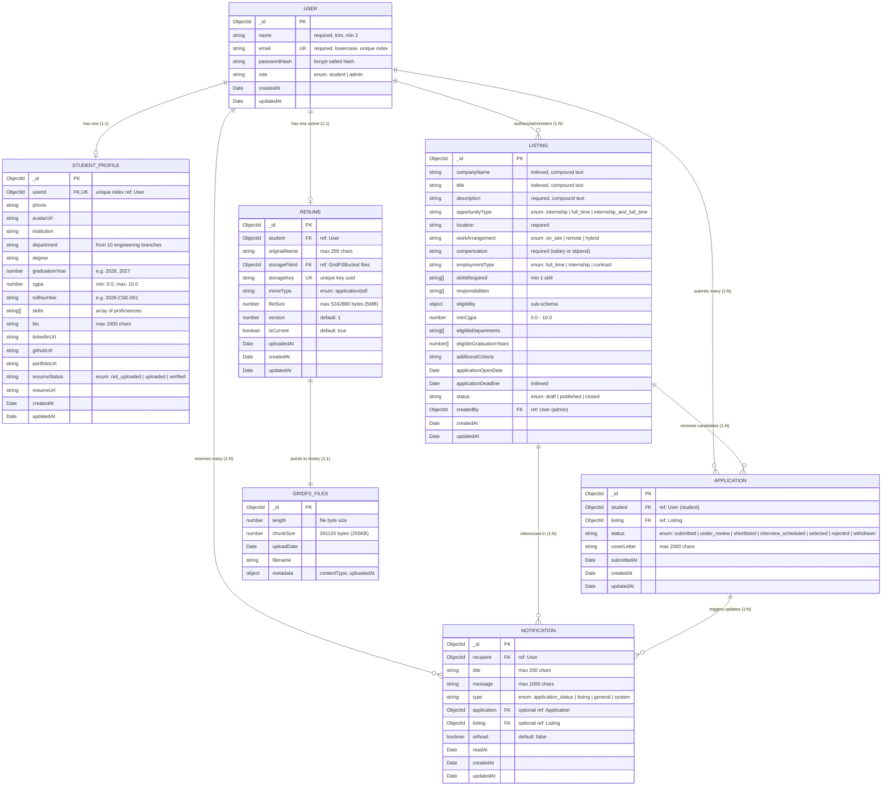

# CampuSync Technical Documentation & Study Guide
## Module 5: Database Design, Mongoose Models & Entity Relational Schema

---

### 1. Database Architecture & Entity Relationship Diagram (ERD)

CampuSync stores operational data in **MongoDB Atlas** using the **`placement_portal`** database namespace. Relationships between documents are established through MongoDB ObjectIds (`Schema.Types.ObjectId`), modeled and queried using **Mongoose ODM**.

---

### 2. Collection Specifications & Schema Details

---

#### Collection 1: `users` ([`server/src/models/user.model.ts`](../../server/src/models/user.model.ts))
- **Purpose**: Stores authentication credentials, identity information, and access roles for all system users (both students and administrators).
- **Key Fields**:
  - `name` (String, required): Trimmed full name (2–100 characters).
  - `email` (String, required, unique, lowercase, trimmed): Primary identity handle verified by regex `/^\S+@\S+\.\S+$/`.
  - `passwordHash` (String, required): Salted cryptographic hash generated by `bcryptjs` with salt rounds = 12.
  - `role` (String, enum: `['student', 'admin']`, default: `'student'`): Role governing system authorization.
  - `createdAt` / `updatedAt` (Date): Automatic Mongoose timestamps.
- **Indexes**:
  - Unique single-field index: `{ email: 1 }` (enforces uniqueness at the storage engine level).
- **Security Method**:
  - `toSafeObject()`: Strips `passwordHash`, `__v`, and `_id`, exposing only safe properties (`id`, `name`, `email`, `role`, `createdAt`).

---

#### Collection 2: `studentprofiles` ([`server/src/models/profile.model.ts`](../../server/src/models/profile.model.ts))
- **Purpose**: Holds the rich academic, professional, and personal details of student users needed for placement eligibility.
- **Key Fields**:
  - `userId` (ObjectId, required, unique, ref: `'User'`): 1-to-1 foreign key to `users`.
  - `department` (String, default: `''`): Engineering branch matching the 10 standard university branches.
  - `degree` (String, default: `''`): Academic program (e.g., "B.Tech", "M.Tech", "MCA").
  - `graduationYear` (Number, default: `null`): Anticipated graduation cohort year (e.g., 2026, 2027).
  - `cgpa` (Number, default: `null`, min: 0.0, max: 10.0): Cumulative Grade Point Average.
  - `rollNumber` (String, default: `''`): College registration or matriculation number.
  - `skills` (Array of Strings, default: `[]`): Technical proficiencies and competencies.
  - `bio` (String, max 1000 characters): Professional introduction statement.
  - `linkedInUrl`, `githubUrl`, `portfolioUrl` (String): External profile links.
  - `resumeStatus` (String, enum: `['not_uploaded', 'uploaded', 'verified']`, default: `'not_uploaded'`).
- **Indexes**:
  - Unique index: `{ userId: 1 }`.
- **Business Logic Function**:
  - `calculateProfileCompletion(profile, userName)`: Evaluates completeness across 10 core fields, returning an integer percentage (0–100%) and missing field lists.

---

#### Collection 3: `listings` ([`server/src/models/listing.model.ts`](../../server/src/models/listing.model.ts))
- **Purpose**: Represents on-campus placement drives and internship recruitment postings.
- **Key Fields**:
  - `companyName` (String, required, indexed): Hiring corporate organization.
  - `title` (String, required, indexed): Job or internship designation.
  - `description` (String, required): Detailed position overview.
  - `opportunityType` (String, enum: `['internship', 'full_time', 'internship_and_full_time']`).
  - `location` (String, required): City or territory (e.g., "Bengaluru, Karnataka").
  - `workArrangement` (String, enum: `['on_site', 'remote', 'hybrid']`).
  - `compensation` (String, required): Salary CTC or monthly stipend (e.g., "₹18,50,000 / year").
  - `employmentType` (String, enum: `['full_time', 'internship', 'contract']`).
  - `skillsRequired` (Array of Strings, minimum 1 item required): Technical requirements.
  - `eligibility` (Subdocument):
    - `minCgpa` (Number, default: 0): Minimum cutoff grade point.
    - `eligibleDepartments` (Array of Strings): Allowed engineering branches.
    - `eligibleGraduationYears` (Array of Numbers): Permitted graduation years.
  - `applicationOpenDate` (Date, default: `Date.now`).
  - `applicationDeadline` (Date, required, indexed): Cutoff timestamp after which submissions are blocked.
  - `status` (String, enum: `['draft', 'published', 'closed']`, default: `'draft'`, indexed).
  - `createdBy` (ObjectId, required, ref: `'User'`): Administrator who authored the drive.
- **Indexes**:
  - Full-Text Compound Search Index: `{ title: 'text', companyName: 'text', description: 'text' }`.
  - Compound Performance Index: `{ status: 1, applicationDeadline: 1, opportunityType: 1 }`.
- **Instance Methods**:
  - `isExpired()`: Returns `new Date() > this.applicationDeadline`.
  - `isOpen()`: Returns `this.status === 'published' && !this.isExpired() && new Date() >= this.applicationOpenDate`.

---

#### Collection 4: `applications` ([`server/src/models/application.model.ts`](../../server/src/models/application.model.ts))
- **Purpose**: Connects student candidates to placement drives, tracking application lifecycle states.
- **Key Fields**:
  - `student` (ObjectId, required, ref: `'User'`): The applicant candidate.
  - `listing` (ObjectId, required, ref: `'Listing'`): The targeted opportunity drive.
  - `status` (String, required, enum, default: `'submitted'`, indexed):
    - Supported statuses: `'submitted'`, `'under_review'`, `'shortlisted'`, `'interview_scheduled'`, `'selected'`, `'rejected'`, `'withdrawn'`.
  - `coverLetter` (String, max 2000 characters): Student statement of interest.
  - `submittedAt` (Date, default: `Date.now`).
- **Indexes**:
  - **Compound Unique Index**: `{ student: 1, listing: 1 }` (Forces database-level idempotency: a student can apply to a drive at most once).
  - Compound Query Index: `{ listing: 1, status: 1 }` (Optimizes admin applicant roster filtering).
  - Student Chronology Index: `{ student: 1, createdAt: -1 }` (Speeds up student application history).
- **State Machine Validator**:
  - `isValidStatusTransition(currentStatus, targetStatus)` enforces allowable transitions according to the state machine graph.

---

#### Collection 5: `notifications` ([`server/src/models/notification.model.ts`](../../server/src/models/notification.model.ts))
- **Purpose**: Delivers in-app alerts and updates to users regarding application progress.
- **Key Fields**:
  - `recipient` (ObjectId, required, ref: `'User'`): Target user.
  - `title` (String, max 200 characters): Notification header.
  - `message` (String, max 1000 characters): Contextual explanation.
  - `type` (String, enum: `['application_status', 'listing', 'general', 'system']`).
  - `application` (ObjectId, optional, ref: `'Application'`).
  - `listing` (ObjectId, optional, ref: `'Listing'`).
  - `isRead` (Boolean, default: `false`, indexed).
  - `readAt` (Date, default: `null`).
- **Indexes**:
  - Compound Notification Query Index: `{ recipient: 1, isRead: 1, createdAt: -1 }`.

---

#### Collection 6: `resumes` ([`server/src/models/resume.model.ts`](../../server/src/models/resume.model.ts))
- **Purpose**: Tracks document metadata and versioning for student resumes stored in GridFS.
- **Key Fields**:
  - `student` (ObjectId, required, ref: `'User'`): Owner of the resume.
  - `originalName` (String, max 255 characters): Sanitized display name.
  - `storageFileId` (ObjectId, required): Pointer to the file record in MongoDB GridFS (`resumes.files`).
  - `storageKey` (String, required, unique): Unique UUID key preventing collisions.
  - `mimeType` (String, enum: `['application/pdf']`): Restricts media type to PDF.
  - `fileSize` (Number, max 5MB): Size in bytes.
  - `version` (Number, default: 1): Incremented automatically when replacing existing resumes.
  - `isCurrent` (Boolean, default: `true`): Identifies active version.

---

### 3. Database vs. Application-Level Integrity Enforcement

A critical topic in technical reviews is defending **where constraints are enforced** (defense-in-depth):

| Integrity Concern | Enforced at Database Level (MongoDB / Mongoose) | Enforced at Application Level (Zod / Express / Business Logic) |
|---|---|---|
| **Unique Email Addresses** | `{ email: 1 }` unique index rejects duplicate inserts with MongoDB error 11000. | `User.findOne({ email })` checks presence upfront and throws 409 Conflict. |
| **Preventing Duplicate Applications** | `{ student: 1, listing: 1 }` compound unique index guarantees zero duplicate entries. | `Application.findOne({ student, listing })` pre-checks and returns friendly error. |
| **Valid Status Transitions** | Status enum validates against `APPLICATION_STATUSES`. | `isValidStatusTransition()` verifies transition path (e.g. cannot move from `selected` to `submitted`). |
| **Academic Eligibility** | CGPA schema constraint enforces $0.0 \le \text{cgpa} \le 10.0$. | `evaluateEligibility()` checks candidate department, graduation cohort, and CGPA against drive cutoffs. |
| **Application Deadline** | None (MongoDB does not know current wall-clock time). | Express controller asserts `new Date() <= listing.applicationDeadline` before inserting. |
| **File Type Security** | `resume.model` enforces `mimeType === 'application/pdf'`. | `fileValidation.ts` reads binary buffer magic bytes (`%PDF-`) from disk before saving. |
