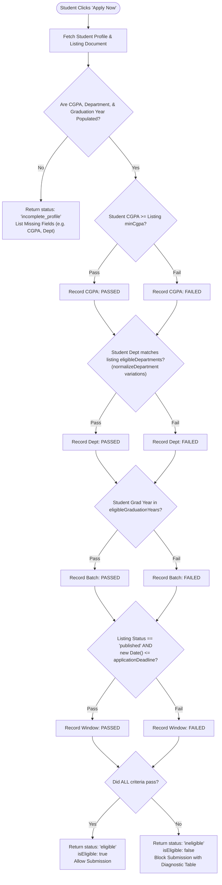
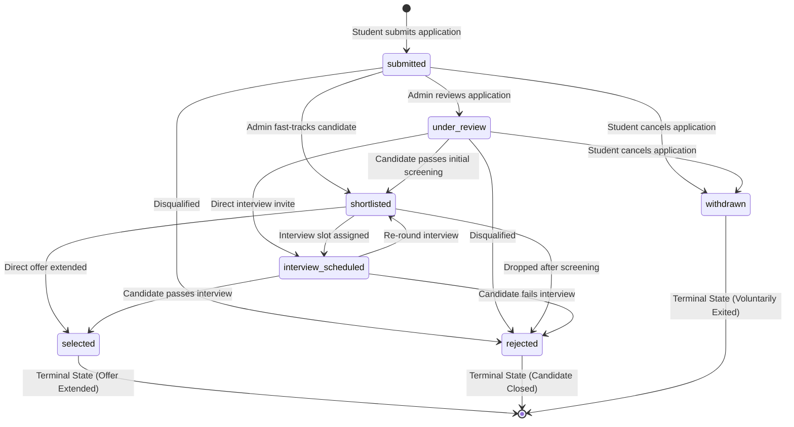

# Module 7: Business Logic, Eligibility Algorithms & Analytics

This module provides a comprehensive technical exploration of the core domain rules, eligibility evaluation algorithms, candidate profile calculations, recruitment state machines, and analytical aggregation pipelines implemented in **CampuSync**.

---

## 1. Automated Eligibility Evaluation Engine

The automated eligibility evaluation engine is located in [`server/src/utils/eligibility.ts`](../../server/src/utils/eligibility.ts). It enforces strict placement criteria before candidates are permitted to submit applications, eliminating recruiter overhead and preventing unqualified submissions.

### 1.1 Architectural Principles of the Evaluator

1. **Deterministic & Explicit**: The evaluator never guesses or infers missing data. If an academic field is missing from the student's profile, it immediately halts and signals `incomplete_profile`.
2. **Multi-Criteria Granularity**: Each individual requirement (CGPA, Department, Graduation Batch, Application Window) is evaluated and returned as a discrete boolean result with actual vs. required values.
3. **Fuzzy Department Matching**: Real-world academic department names contain variances (e.g., `"Computer Science and Engineering (CSE)"` vs `"CSE"` vs `"Computer Science & Engineering"`). The system employs an intelligent string normalization and token variation algorithm.



---

### 1.2 The Department Normalization Algorithm: `normalizeDepartment`

Different recruiters write department names differently from how colleges label degrees. The `normalizeDepartment` function ([`server/src/utils/eligibility.ts#L24-L50`](../../server/src/utils/eligibility.ts#L24-L50)) generates a deduplicated `Set` of normalized string variations:

```typescript
export const normalizeDepartment = (dept: string): string[] => {
  if (!dept) return [];
  const clean = dept.trim().toLowerCase();
  const variations = new Set<string>([clean]);

  // 1. Extract acronym inside parentheses
  // e.g., "Computer Science and Engineering (CSE)" -> extracts "cse"
  const acronymMatch = clean.match(/\(([a-z0-9]+)\)/i);
  if (acronymMatch && acronymMatch[1]) {
    variations.add(acronymMatch[1].toLowerCase());
  }

  // 2. Remove parentheses and bracketed text
  // e.g., "Computer Science and Engineering (CSE)" -> "computer science and engineering"
  const withoutParens = clean.replace(/\s*\([^)]*\)/g, '').trim();
  if (withoutParens) {
    variations.add(withoutParens);
  }

  // 3. Handle '&' versus 'and' interchanges
  // e.g., "Electronics & Communication" <-> "Electronics and Communication"
  variations.add(clean.replace(/&/g, 'and').replace(/\s+/g, ' ').trim());
  variations.add(clean.replace(/\band\b/g, '&').replace(/\s+/g, ' ').trim());
  if (withoutParens) {
    variations.add(withoutParens.replace(/&/g, 'and').replace(/\s+/g, ' ').trim());
    variations.add(withoutParens.replace(/\band\b/g, '&').replace(/\s+/g, ' ').trim());
  }

  return Array.from(variations);
};
```

#### How Match Validation Operates:
When matching student department against listing departments:
1. `studentVariations` is computed from student's profile department.
2. For each listing department, `listingVariations` is computed.
3. The match succeeds if:
   - Any `sVar === lVar` (exact match of variation), OR
   - For variation tokens with length $\ge 3$, one contains the other (`sVar.includes(lVar) || lVar.includes(sVar)`).

---

### 1.3 Step-by-Step Execution of `evaluateEligibility`

```typescript
export const evaluateEligibility = (
  profile: Partial<IStudentProfile> | null | undefined,
  listing: IListing
): EligibilityEvaluationResult => {
```

#### Step 1: Academic Data Audit
If `profile` is null, or if `profile.cgpa`, `profile.department`, or `profile.graduationYear` are missing or unpopulated:
```typescript
if (missingProfileFields.length > 0) {
  return {
    isEligible: false,
    status: 'incomplete_profile',
    summary: `Your student profile is missing: ${missingProfileFields.join(', ')}. Please update your profile to evaluate drive eligibility.`,
    criteria: [],
    missingProfileFields,
  };
}
```

#### Step 2: Cumulative CGPA Cutoff
- If `listing.eligibility.minCgpa` is set (e.g., `8.0`):
  $$\text{met} = \text{studentCgpa} \ge \text{minCgpa}$$
- If `minCgpa` is `0` or undefined, `met = true` ("No minimum cutoff").

#### Step 3: Department / Branch Whitelist
- If `listing.eligibility.eligibleDepartments` has items:
  - Compares `studentVariations` against all `listingVariations`.
- If the whitelist is empty, all departments are eligible (`met = true`).

#### Step 4: Graduation Batch Whitelist
- If `listing.eligibility.eligibleGraduationYears` has items:
  $$\text{met} = \text{eligibleYears.some}(y \implies \text{Number}(y) === \text{Number}(studentYear))$$
- If empty, all graduation cohorts are eligible (`met = true`).

#### Step 5: Application Window & Publishing Status
- Checks whether `new Date() <= new Date(listing.applicationDeadline)`.
- Checks whether `listing.status === 'published'`.

#### Result Synthesis:
```typescript
const allCriteriaMet = criteria.every((c) => c.met);

return {
  isEligible: allCriteriaMet,
  status: allCriteriaMet ? 'eligible' : 'ineligible',
  summary: allCriteriaMet
    ? 'You meet all academic criteria and the drive is open for applications.'
    : 'You do not meet one or more eligibility criteria for this opportunity.',
  criteria,
  missingProfileFields: [],
};
```

---

## 2. Profile Completion Algorithm

The profile completeness scorer is implemented in [`server/src/models/profile.model.ts#L134-L210`](../../server/src/models/profile.model.ts#L134-L210). It powers the student dashboard progress bar and badges.

### 2.1 The 10 Core Profile Fields

The algorithm inspects exactly 10 mandatory attributes:

| Field Index | Key | UI Label | Validation Check Condition |
|:---:|:---|:---|:---|
| 1 | `name` | Full Name | `userName && userName.trim().length > 0` |
| 2 | `phone` | Phone Number | `profile.phone && profile.phone.trim().length > 0` |
| 3 | `rollNumber` | Roll / Registration Number | `profile.rollNumber && profile.rollNumber.trim().length > 0` |
| 4 | `institution` | Institution / College | `profile.institution && profile.institution.trim().length > 0` |
| 5 | `department` | Department / Branch | `profile.department && profile.department.trim().length > 0` |
| 6 | `degree` | Degree | `profile.degree && profile.degree.trim().length > 0` |
| 7 | `graduationYear` | Graduation Year | `typeof profile.graduationYear === 'number' && profile.graduationYear > 2000` |
| 8 | `cgpa` | Cumulative GPA (CGPA) | `typeof profile.cgpa === 'number' && profile.cgpa >= 0.0 && profile.cgpa <= 10.0` |
| 9 | `skills` | Skills & Proficiencies | `Array.isArray(profile.skills) && profile.skills.length > 0` |
| 10 | `bio` | Short Biography | `profile.bio && profile.bio.trim().length >= 10` |

### 2.2 Mathematical Formula

$$\text{Percentage} = \text{round}\left( \frac{\text{Completed Requirements Count}}{10} \times 100 \right)$$

$$\text{isComplete} = (\text{Percentage} == 100)$$

If a student has completed 8 out of 10 requirements, the score is:
$$\text{round}\left(\frac{8}{10} \times 100\right) = 80\%$$

The function returns a `ProfileCompletionResult`:
```typescript
export interface ProfileCompletionResult {
  percentage: number;
  completedFields: string[];
  missingFields: string[];
  isComplete: boolean;
}
```

---

## 3. Application Lifecycle State Machine

The candidate application state machine manages transitions through the recruitment pipeline.



### 3.1 Transition Rules Matrix (`VALID_STATUS_TRANSITIONS`)

Defined in [`server/src/models/application.model.ts#L31-L39`](../../server/src/models/application.model.ts#L31-L39):

| Current Status | Permitted Next Statuses | Terminal? | Notes |
|:---|:---|:---:|:---|
| `submitted` | `under_review`, `shortlisted`, `rejected` | No | Initial state after submission |
| `under_review` | `shortlisted`, `interview_scheduled`, `rejected` | No | Actively being screened |
| `shortlisted` | `interview_scheduled`, `selected`, `rejected` | No | Candidate cleared profile review |
| `interview_scheduled` | `shortlisted`, `selected`, `rejected` | No | Candidate invited to technical/HR rounds |
| `selected` | *(None)* | **Yes** | Final recruitment offer extended |
| `rejected` | *(None)* | **Yes** | Recruitment process concluded |
| `withdrawn` | *(None)* | **Yes** | Student initiated withdrawal |

### 3.2 Student Withdrawal Rules

Students are **only** permitted to voluntarily withdraw an application while it is in its early stages:
```typescript
export const WITHDRAWABLE_STATUSES: ApplicationStatus[] = ['submitted', 'under_review'];

applicationSchema.methods.canWithdraw = function (): boolean {
  return WITHDRAWABLE_STATUSES.includes(this.status);
};
```
Once an application transitions to `shortlisted`, `interview_scheduled`, `selected`, or `rejected`, candidate withdrawal is locked out to preserve placement office interview schedules.

### 3.3 Automated Notification Creation

Whenever an administrator successfully transitions an application's status in `updateApplicationStatus` ([`server/src/controllers/application.controller.ts#L509-L537`](../../server/src/controllers/application.controller.ts#L509-L537)), an asynchronous in-app notification is automatically generated for the applicant:

```typescript
await Notification.create({
  recipient: application.student,
  title: `Application Status: ${readableStatus}`,
  message: `Your application for ${jobTitle} at ${companyName} has been updated to "${readableStatus}".`,
  type: 'application_status',
  application: application._id,
  listing: application.listing,
  isRead: false,
});
```

---

## 4. Placement Analytics & Aggregation Engine

The analytics engine in [`server/src/services/analytics.service.ts`](../../server/src/services/analytics.service.ts) aggregates campus recruitment statistics across the entire database.

### 4.1 Key Performance Indicators (KPIs)

The `getKPIMetrics()` function runs concurrent asynchronous queries to compute primary metrics:

```typescript
const [
  totalStudents,
  activeOpportunities,
  totalApplications,
  distinctSelectedStudents,
  totalOffers,
] = await Promise.all([
  User.countDocuments({ role: 'student' }),
  Listing.countDocuments({
    status: 'published',
    applicationDeadline: { $gte: now },
  }),
  Application.countDocuments(),
  Application.distinct('student', { status: 'selected' }),
  Application.countDocuments({ status: 'selected' }),
]);
```

#### Deduplication in Placement Rate Calculation:
A high-performing student may receive job offers from multiple companies (e.g., Google and Amazon).
- If raw selected application count was used, the placement rate could erroneously exceed 100%.
- CampuSync executes `Application.distinct('student', { status: 'selected' })`, returning an array of unique student ObjectIds who received at least one offer.

$$\text{Placement Rate (\%)} = \begin{cases}
\text{round}\left(\frac{\text{Unique Selected Students Count}}{\text{Total Registered Students}} \times 100, 1\right), & \text{if Total Students} > 0 \\
0, & \text{otherwise}
\end{cases}$$

$$\text{Selection Rate (\%)} = \begin{cases}
\text{round}\left(\frac{\text{Total Offers Extended}}{\text{Total Submitted Applications}} \times 100, 1\right), & \text{if Total Applications} > 0 \\
0, & \text{otherwise}
\end{cases}$$

---

### 4.2 Application Status Distribution Pipeline

Computes the percentage breakdown across all 7 statuses to render the distribution chart on the Admin Dashboard:

```typescript
export async function getStatusDistribution(
  totalApplications: number
): Promise<StatusDistributionItem[]> {
  const statusCounts = await Promise.all(
    APPLICATION_STATUSES.map(async (status) => {
      const count = await Application.countDocuments({ status });
      const percentage =
        totalApplications > 0
          ? Number(((count / totalApplications) * 100).toFixed(1))
          : 0;

      return {
        status,
        label: formatStatusLabel(status),
        count,
        percentage,
      };
    })
  );
  return statusCounts;
}
```

---

### 4.3 Company Application Aggregation Pipeline

To determine the most popular recruiters by student volume, CampuSync executes a MongoDB Aggregation Pipeline:

```typescript
const aggResults = await Application.aggregate([
  // 1. Join with listings collection
  {
    $lookup: {
      from: 'listings',
      localField: 'listing',
      foreignField: '_id',
      as: 'listingData',
    },
  },
  // 2. Deconstruct array to single object
  { $unwind: '$listingData' },
  // 3. Group by company name and count
  {
    $group: {
      _id: '$listingData.companyName',
      applicationCount: { $sum: 1 },
    },
  },
  // 4. Sort descending by count, then alphabetically
  { $sort: { applicationCount: -1, _id: 1 } },
  // 5. Take top 10 companies
  { $limit: 10 },
]);
```

#### Fault-Tolerant Fallback:
If the MongoDB cluster fails to execute the aggregation pipeline (e.g., in legacy or non-replica mock environments), the service automatically falls back to an in-memory aggregation via `Application.find().populate('listing')` and a JavaScript `Map<string, number>`.

---

### 4.4 Recruitment Pipeline Stages Aggregation

The `getPlacementActivitySummary()` function aggregates the recruitment funnel into 5 top-level operational stages:

$$\text{inReview} = \text{count}(\text{submitted}) + \text{count}(\text{under\_review})$$

$$\text{interviewing} = \text{count}(\text{shortlisted}) + \text{count}(\text{interview\_scheduled})$$

$$\text{selected} = \text{count}(\text{selected})$$

$$\text{rejected} = \text{count}(\text{rejected})$$

$$\text{withdrawn} = \text{count}(\text{withdrawn})$$

---

## 5. Security & Integrity in Business Operations

1. **Compound Index Prevention of Race Conditions**:
   The unique index `{ student: 1, listing: 1 }` guarantees that even if a student rapidly clicks the "Submit Application" button multiple times, MongoDB rejects duplicate concurrent operations at the storage engine level with an `E11000` duplicate key violation.
2. **Immutable Submitted Timestamp**:
   The `submittedAt` timestamp is recorded by the server on write (`Date.now`), preventing client tampering with submission deadlines.
3. **Strict Validation Middleware**:
   All inputs passed into these business algorithms are pre-validated by Zod schemas (`submitApplicationSchema`, `updateApplicationStatusSchema`, `queryApplicationsSchema`), ensuring that negative numbers, malformed ObjectIds, or invalid enum values never reach the business logic.
