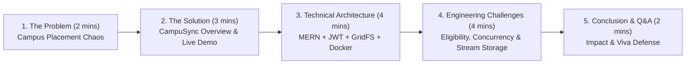

# Module 8: College Viva Defense, Technical Q&A & Interview Guide

This guide prepares you to deliver a top-tier project presentation to college professors, defend your architectural decisions during your viva examination, and answer in-depth technical questions during software engineering interviews.

---

## 1. College Viva Presentation Script & Roadmap (10–15 Minutes)

Use this structured roadmap to present **CampuSync** cleanly and professionally.



### 1.1 Step-by-Step Presentation Script

#### Slide 1: Introduction & Problem Statement (2 Minutes)
> *"Good morning, respected professors and evaluators. Today, I am presenting **CampuSync**, an enterprise-grade Student Placement and Internship Management Portal.*
>
> *In most engineering colleges, campus placements are managed through a chaotic mixture of Google Forms, Excel spreadsheets, Telegram groups, and manual email notifications. This creates severe inefficiencies: students miss application deadlines, unqualified applicants slip past criteria cutoffs, training and placement officers (TPOs) spend days manually cross-referencing CGPA and branch cutoffs, and confidential student resumes are scattered across unencrypted shared drives.*
>
> *CampuSync solves this by unifying students and placement administrators onto a single, secure, automated, and real-time portal."*

#### Slide 2: High-Level Architecture & Live Demo Walkthrough (3 Minutes)
> *"CampuSync is built on the modern MERN architecture using TypeScript end-to-end:*
> - *A React 18 single-page application built with Vite and Tailwind CSS.*
> - *A Node.js and Express RESTful backend with strict Zod runtime schema validation.*
> - *A MongoDB database managed through Mongoose, utilizing MongoDB GridFS for binary resume chunk streaming.*
>
> *Let us walk through the two core user journeys:*
> 1. ***Student Experience***: *A candidate logs in, views their profile completion score, browses active drives, and sees real-time eligibility feedback. If a drive requires an 8.0 CGPA and CSE/IT branches, our engine instantly evaluates their profile against the criteria. They apply in one click without re-uploading documents.*
> 2. ***TPO / Administrator Experience***: *Placement officers post drives, track candidate stages across a 7-stage state machine (`submitted` $\to$ `under_review` $\to$ `shortlisted` $\to$ `interview_scheduled` $\to$ `selected`), view candidate resumes streamed directly from GridFS, and inspect real-time recruitment KPIs with deduplicated placement rate metrics."*

#### Slide 3: Core Engineering Highlights (4 Minutes)
> *"Three core engineering highlights set CampuSync apart from basic student CRUD apps:*
> 1. ***Automated Fuzzy Eligibility Evaluator***: *Handles department acronyms and variations (such as CSE vs Computer Science and Engineering) and evaluates CGPA, graduation batch, and application window before accepting an application.*
> 2. ***Database-Level Concurrency & Integrity***: *We prevent duplicate applications using a compound unique index on `{ student: 1, listing: 1 }` backed by MongoDB's WiredTiger storage engine, preventing race conditions.*
> 3. ***Native GridFS Binary Streaming***: *Resumes are validated at the byte level for PDF magic signatures (`%PDF-`), chunked into 255KB blocks, and streamed directly from the database through Express without saving files to server disk."*

#### Slide 4: Real-World Deployment (2 Minutes)
> *"The system is live in production: the frontend is deployed on Vercel, the backend API runs on Render, and data is persisted on a high-availability MongoDB Atlas replica set, with isolated production and development environments."*

---

## 2. Architectural & Design Decision Defenses

Be prepared to answer: *"Why did you build it this way instead of using alternatives?"*

### Defense 1: Why MERN (TypeScript + React + Node.js + Express + MongoDB) instead of a Relational Monolith (Django / PostgreSQL or Spring Boot)?

- **Unified Language (TypeScript Across the Stack)**: Using TypeScript on both client and server allows sharing domain types, contracts, and error structures. This reduces cognitive switching and prevents contract drift between the API and UI.
- **Asynchronous, Event-Driven I/O**: Recruitment portals involve heavy I/O operations (file streaming, multi-query dashboard aggregations, email/notification dispatch) rather than CPU-heavy computation. Node.js’s non-blocking event loop handles hundreds of concurrent student submissions with minimal memory footprint compared to multi-threaded Java Spring threads.
- **Rapid UI Responsiveness**: A React SPA provides immediate client-side route transitions and optimistic UI updates without full-page reloads, essential for a high-stress campus recruitment drive.

### Defense 2: Why MongoDB (NoSQL) over PostgreSQL (SQL) for this Project?

- **Flexible & Evolving Schema**: Recruitment listings have diverse structures: some roles have multiple assessment rounds, varying stipend structures, complex department whitelists, and custom eligibility rules. MongoDB's document model represents these rich subdocuments natively without requiring 5+ relational JOIN tables (`listing_eligibility`, `listing_skills`, `listing_rounds`).
- **Native Binary Storage with GridFS**: MongoDB provides GridFS out of the box. By storing student resumes in GridFS, our entire persistence layer—metadata, user credentials, application records, and binary files—lives in a single, unified, backed-up database cluster.
- **High Read-to-Write Ratio with Embedded Aggregation**: Placement listings are read hundreds of times by students for every single write. MongoDB allows us to denormalize and embed eligibility rules directly inside the listing document, fetching the entire opportunity in a single query.

### Defense 3: Why Store JWT in `localStorage` instead of `HttpOnly` Cookies?

- **Decoupled Cross-Origin Architecture**: In production, CampuSync's frontend is hosted on Vercel (`campusync-orcin.vercel.app`) while the backend API is hosted on Render (`campusync-api.onrender.com`). Different top-level domains make cross-origin third-party cookie handling complex due to browser SameSite/Third-Party cookie deprecations (Safari ITP and Chrome Privacy Sandbox).
- **Standard `Authorization: Bearer <token>` Headers**: Storing the JWT in client memory/`localStorage` and attaching it via Axios request interceptors allows clean, explicit API authorization across different subdomains or third-party client apps (e.g., future mobile applications).
- **XSS Mitigation Strategy**: To protect `localStorage` against Cross-Site Scripting (XSS):
  1. React automatically escapes all string outputs in JSX, preventing raw script injections.
  2. The application never uses `dangerouslySetInnerHTML`.
  3. Strict input sanitization is enforced via Zod schemas.
  4. Helmet security headers disable malicious external scripts (`X-Content-Type-Options: nosniff`, `X-Frame-Options: DENY`).

### Defense 4: Why MongoDB GridFS instead of AWS S3 or Local Disk Storage?

| Storage Option | Why Rejected or Chosen |
|:---|:---|
| **Local Disk Storage** | **Rejected**: Modern cloud platforms like Render, Heroku, and AWS Lambda have **ephemeral filesystems**. Any file written to the local `/uploads` directory is completely erased on server restart or redeployment. |
| **AWS S3 / Cloud Storage** | **Deferred for MVP**: Requires third-party cloud billing, AWS IAM access key provisioning, bucket CORS configuration, and network latency on uploads. |
| **MongoDB GridFS** | **Chosen**: Bundled inside MongoDB Atlas. Resumes are chunked into 255KB blocks, stored alongside metadata, included in daily automated database backups, and streamed directly to HTTP clients with zero external cloud dependencies. |

### Defense 5: Why Use Zod Runtime Validation When TypeScript is Already Used?

- **TypeScript Types Disappear at Runtime**: TypeScript only provides static compile-time type checking. Once code compiles to JavaScript (`npm run build`), all TypeScript interfaces are completely stripped away.
- **Untrusted External Data**: An API receives raw JSON strings from untrusted external HTTP requests. TypeScript cannot prevent a malicious user from sending a negative CGPA, an invalid enum string, or SQL/NoSQL injection payloads.
- **Zod Enforces Runtime Integrity**: Zod schemas (`safeParse` and `parse`) validate incoming JSON at runtime, parsing and rejecting invalid data before it ever reaches controller handlers or database queries.

---

## 3. Top 30 Technical Viva & Interview Questions with Model Answers

### Category 1: Full-Stack Architecture & Request Lifecycle

#### Q1: What happens under the hood when a student logs into CampuSync?
> **Answer**:
> 1. The user enters email and password in `LoginPage.tsx`.
> 2. `apiClient.post('/api/auth/login')` sends an HTTP POST request to Express.
> 3. The request passes through `cors`, `helmet`, and `generalLimiter`.
> 4. `authController.login` extracts credentials and runs `loginSchema.parse(req.body)`.
> 5. It queries `User.findOne({ email }).select('+passwordHash')`.
> 6. It calls `bcrypt.compare(password, user.passwordHash)`.
> 7. If valid, `jwt.sign()` generates a signed JWT containing `{ userId, email, role }` with a 7-day expiration.
> 8. The server responds with `200 OK`, returning the user profile and token.
> 9. The frontend `AuthContext` stores the token in `localStorage`, updates React state, and redirects the student to the dashboard.

#### Q2: How does CampuSync handle CORS in production?
> **Answer**:
> In [`server/src/app.ts`](../../server/src/app.ts), the backend configures `cors({ origin: env.CLIENT_URL, credentials: true })`. If an incoming request's `Origin` header does not match the configured client URL (e.g., `https://campusync-orcin.vercel.app`), the browser blocks the response. In development, multiple local origins (e.g., `http://localhost:5173`) are supported.

#### Q3: What is the purpose of the `apiClient` Axios interceptor on the frontend?
> **Answer**:
> In [`client/src/api/client.ts`](../../client/src/api/client.ts), Axios request interceptors automatically read the JWT from `localStorage` and attach it as `Authorization: Bearer <token>` to every outgoing HTTP request. Furthermore, the response interceptor catches `401 Unauthorized` responses and automatically clears invalid credentials, redirecting the user to `/login`.

#### Q4: Why does CampuSync separate business logic into routes, controllers, services, and models?
> **Answer**:
> To adhere to the **Separation of Concerns (SoC)** and **Single Responsibility Principle (SRP)**:
> - **Routes**: Define URL paths and chain middleware (authentication, validation).
> - **Controllers**: Handle HTTP protocol concerns (parsing request bodies, setting response status codes).
> - **Services**: Encapsulate complex business rules and multi-step data transformations (e.g., `analytics.service.ts`).
> - **Models**: Define data schemas, database indexes, and model-level lifecycle methods.

#### Q5: How do you gracefully shut down the Express server during deployment?
> **Answer**:
> In [`server/src/server.ts`](../../server/src/server.ts), listeners are attached to `SIGTERM` and `SIGINT`. When Render or Docker shuts down a container:
> 1. The HTTP server stops accepting new incoming connections (`server.close()`).
> 2. Active requests are allowed to finish.
> 3. The Mongoose database connection is safely closed (`mongoose.connection.close()`).
> 4. The process exits with code 0 (`process.exit(0)`).

---

### Category 2: Frontend & React Internals

#### Q6: How does `<ProtectedRoute>` enforce role-based route protection on the client?
> **Answer**:
> In [`client/src/components/ProtectedRoute.tsx`](../../client/src/components/ProtectedRoute.tsx), the component consumes `useAuth()`. If `loading` is true, it renders a loading spinner. If `isAuthenticated` is false, it redirects to `/login`. If an `allowedRoles` prop is provided and the current user's role does not match, it redirects the student to the dashboard with an unauthorized notice.

#### Q7: Why do we use React Context (`AuthContext`) instead of prop drilling for user state?
> **Answer**:
> User authentication status, profile details, and role must be accessed by components located across the entire component tree—Navbar, ProtectedRoute, Dashboard, Profile, and Application cards. React Context provides a centralized state subscription model without having to pass props through intermediate layout components.

#### Q8: What is the difference between client-side validation and server-side validation?
> **Answer**:
> - **Client-side validation**: Improves user experience (UX) by providing instant feedback before form submission (e.g., HTML5 `required`, minimum length checks).
> - **Server-side validation**: Enforces security and system integrity. Because client-side code can easily be bypassed using curl or Postman, the server must validate all incoming payloads using Zod schemas.

#### Q9: How does React 18 manage concurrent rendering and how does it benefit CampuSync?
> **Answer**:
> React 18 introduces concurrent rendering features such as automatic batching of state updates (combining multiple `setState` calls inside asynchronous promises or timeouts into a single render pass), which prevents unnecessary intermediate UI re-renders during dashboard data fetching.

#### Q10: How do you test React components in CampuSync?
> **Answer**:
> Using **Vitest** and **React Testing Library** in jsdom environment. Tests simulate user interactions (clicking buttons, typing text) on rendered components and assert changes in the DOM, mocking network calls via Mock Service Worker (MSW) or Vitest spy functions (`vi.spyOn`).

---

### Category 3: Backend, Node.js & Express Internals

#### Q11: Explain how Express middleware works in CampuSync.
> **Answer**:
> Middleware functions are functions that have access to the request (`req`), response (`res`), and the `next` function in the application's request-response cycle. In CampuSync, they execute sequentially:
> 1. Global middleware: `cors()`, `helmet()`, `express.json()`, `rateLimiter`.
> 2. Route middleware: `authenticate` (verifies JWT), `authorize('admin')` (checks role), `validate(schema)` (validates body).
> 3. Error-handling middleware: `errorHandler` (catches unhandled exceptions and formats consistent JSON responses).

#### Q12: How does the centralized error handler (`errorHandler.ts`) distinguish between operational errors and programmer bugs?
> **Answer**:
> We implement a custom `AppError` class inheriting from `Error` with properties `statusCode` and `isOperational = true`.
> - If `err.isOperational` is true (e.g., 404 Not Found, 400 Bad Request, 409 Conflict), the handler sends the specific error message to the client.
> - If it is an unexpected programmer bug or library error (`isOperational = false`), the handler logs the full stack trace on the server and returns a generic `500 Internal Server Error` to the client in production to prevent leaking sensitive internal details.

#### Q13: What is the purpose of `express-rate-limit` in CampuSync?
> **Answer**:
> Rate limiting protects the server from brute-force attacks and denial-of-service (DoS) attempts:
> - `authLimiter`: Limits authentication attempts (e.g., max 10 requests per 15 minutes per IP on `/api/auth/login`).
> - `generalLimiter`: Enforces a generous ceiling on standard API endpoints (e.g., 200 requests per 15 minutes) to protect database resources.

#### Q14: How does CampuSync handle asynchronous errors in Express routes?
> **Answer**:
> All asynchronous controller functions are wrapped in standard `try...catch` blocks that forward caught exceptions to `next(error)`. Express routes these directly into the centralized 4-parameter error middleware (`(err, req, res, next)`).

#### Q15: Why is Node.js single-threaded event loop suitable for this application?
> **Answer**:
> CampuSync is **I/O-bound**, spending most of its execution time awaiting database queries, reading network requests, and streaming binary chunks. Node.js delegates these I/O tasks to libuv worker threads and OS-level asynchronous primitives (epoll/kqueue), allowing the single main thread to continue processing concurrent student requests without blocking.

---

### Category 4: Database, Mongoose & Indexing

#### Q16: What is a compound unique index and why is it used on the `Application` collection?
> **Answer**:
> In [`server/src/models/application.model.ts`](../../server/src/models/application.model.ts), we declare:
> ```typescript
> applicationSchema.index({ student: 1, listing: 1 }, { unique: true });
> ```
> This creates a compound index on the combination of `student` and `listing` ObjectIds. It enforces at the database storage engine level that a student can never submit more than one application to the same recruitment drive, preventing race conditions from concurrent duplicate HTTP requests.

#### Q17: What is the difference between referencing and embedding in MongoDB? Where does CampuSync use each?
> **Answer**:
> - **Referencing (Normalized)**: Documents store the `_id` of documents in another collection (like Foreign Keys). Used where documents have independent lifecycles or unbounded growth: `Application.student -> User`, `Application.listing -> Listing`.
> - **Embedding (Denormalized)**: Related data is stored as subdocuments inside the parent document. Used for tightly coupled data with bounded size: `Listing.eligibility` (minCgpa, eligibleDepartments) is embedded directly inside `Listing` because it is always queried and updated with the listing.

#### Q18: How does the Mongoose `toJSON` transform protect sensitive data?
> **Answer**:
> In Mongoose schemas, the `toJSON: { transform(doc, ret) }` hook strips internal fields before documents are serialized into JSON:
> - Converts `_id` to virtual `id`.
> - Deletes `_id`, `__v`, and sensitive fields like `passwordHash`.
> - Ensures that `res.json(user)` never accidentally exposes password hashes over the network.

#### Q19: How does the analytics engine calculate the placement rate without inflating it for students with multiple offers?
> **Answer**:
> In [`server/src/services/analytics.service.ts`](../../server/src/services/analytics.service.ts), instead of counting all applications with status `selected`, it executes:
> ```typescript
> Application.distinct('student', { status: 'selected' });
> ```
> This returns a deduplicated array of unique student IDs who have received at least one offer. The placement rate is then:
> $$\text{Placement Rate} = \frac{\text{uniqueSelectedStudents.length}}{\text{totalRegisteredStudents}} \times 100$$

#### Q20: What are Mongoose Virtuals and Population?
> **Answer**:
> - **Virtuals**: Document properties that can be read or set but are not persisted to MongoDB (e.g., `id` virtual mapping from `_id`).
> - **Population**: The Mongoose mechanism to automatically replace referenced ObjectIds in a document with the actual document from another collection (similar to a SQL `LEFT JOIN`).

---

### Category 5: Security, Authentication & File Handling

#### Q21: How are passwords hashed and why is plain MD5 or SHA256 insufficient?
> **Answer**:
> Passwords are hashed using **bcrypt** with a cost factor of 12 rounds. MD5 and SHA256 are fast cryptographic hashes designed for integrity verification; modern GPUs can compute billions of SHA256 hashes per second, making them vulnerable to rainbow table attacks and brute force. Bcrypt is an adaptive key derivation function with an intentional computational delay and unique per-password salt.

#### Q22: What information is stored inside the CampuSync JWT and how is it verified?
> **Answer**:
> The JWT payload contains only non-sensitive identity claims: `{ userId, email, role }`. The header and payload are cryptographically signed using `HMAC-SHA256` with a high-entropy secret (`JWT_SECRET`). When a request arrives, `jwt.verify(token, secret)` recomputes the signature. If any bit of the payload was tampered with, signature verification fails and the request is rejected with `401 Unauthorized`.

#### Q23: How does CampuSync prevent Insecure Direct Object References (IDOR)?
> **Answer**:
> When a student requests their applications via `GET /api/applications/my-applications` or attempts to withdraw an application, the backend does **not** rely on student IDs supplied in the request body or query parameter. Instead, it queries:
> ```typescript
> Application.findOne({ _id: req.params.id, student: req.user._id });
> ```
> `req.user._id` comes exclusively from the cryptographically verified JWT payload, preventing Student A from viewing or modifying Student B's application.

#### Q24: How does file validation prevent malicious uploads (e.g., an executable disguised as a PDF)?
> **Answer**:
> In [`server/src/utils/fileValidation.ts`](../../server/src/utils/fileValidation.ts), the application performs a 3-layer validation:
> 1. **File Extension**: Verifies the filename ends in `.pdf`.
> 2. **MIME Type**: Verifies `req.file.mimetype === 'application/pdf'`.
> 3. **Magic Byte Signature**: Reads the first 5 bytes of the file buffer and checks for `%PDF-` (`0x25, 0x50, 0x44, 0x46, 0x2d`). Even if an attacker renames `malware.exe` to `resume.pdf`, it is rejected because its binary magic bytes do not match the PDF standard.

#### Q25: How does MongoDB GridFS store files larger than 16MB?
> **Answer**:
> MongoDB documents have a 16MB BSON limit. GridFS overcomes this by dividing files into two collections:
> - `fs.files`: Stores file metadata (filename, upload date, size, content-type).
> - `fs.chunks`: Stores the binary data divided into fixed chunks (default 255KB each), indexed by `{ files_id: 1, n: 1 }`.
> CampuSync streams these chunks using Node.js readable streams directly to the HTTP response, avoiding memory spikes on the server.

---

### Category 6: System Design, Scaling & Production Operations

#### Q26: If 5,000 students apply for a Google drive simultaneously at 10:00 AM, how would CampuSync handle the load?
> **Answer**:
> 1. **Stateless API Layer**: The Express backend is completely stateless (sessions are in JWTs), allowing it to scale horizontally behind a reverse proxy (like NGINX or AWS ALB).
> 2. **Database Connection Pooling**: Mongoose maintains an active connection pool (default 10-50 connections) to reuse open TCP sockets to MongoDB Atlas.
> 3. **Indexes**: The lookup for `Listing.findById` and `StudentProfile.findOne` uses indexed fields (`_id`, `userId`), ensuring $O(\log N)$ B-tree index seeks rather than full-collection scans.
> 4. **Future Scalability Recommendation**: For massive spikes, introduce a message broker like Redis/BullMQ to queue application submission tasks asynchronously and return a `202 Accepted` receipt to the client.

#### Q27: How does CampuSync handle secrets management between development and production?
> **Answer**:
> - In **development**: Secrets are stored in local `.env` files that are strictly excluded from version control via `.gitignore`.
> - In **production**: Secrets (`MONGODB_URI`, `JWT_SECRET`, `CLIENT_URL`) are injected as encrypted environment variables directly through the hosting provider's dashboard (Render and Vercel).
> - On startup, [`server/src/config/env.ts`](../../server/src/config/env.ts) uses Zod to validate that all required production secrets exist; if any are missing or weak, the server fails fast and exits immediately.

#### Q28: How do you prevent cross-site request forgery (CSRF)?
> **Answer**:
> Because CampuSync uses Bearer tokens stored in `localStorage` and sent via the custom `Authorization` header rather than ambient browser cookies, browsers do not automatically attach the token on cross-origin requests. A malicious website cannot forge an authenticated request on behalf of a logged-in user.

#### Q29: What is the purpose of the 7-stage application status state machine?
> **Answer**:
> It prevents illegal workflow transitions (e.g., an administrator cannot transition a candidate from `submitted` directly to `selected` without screening, or reopen an application that has been `withdrawn` or `rejected`). The allowed paths are codified in `VALID_STATUS_TRANSITIONS` and enforced in `isValidStatusTransition()`.

#### Q30: What future improvements would you recommend for CampuSync?
> **Answer**:
> 1. **Email / SMS Notifications**: Integrate SendGrid or AWS SES for real-time email alerts alongside in-app notifications.
> 2. **Automated Resume Parsing**: Use an LLM or OCR parser to automatically populate a student's profile from an uploaded PDF.
> 3. **Interview Scheduling & Calendar Sync**: Add calendar invites with Google Calendar / Outlook integration for interview slots.
> 4. **Export to CSV / Excel**: Allow TPOs to export shortlisted candidate batches with one click for campus recruiters.
